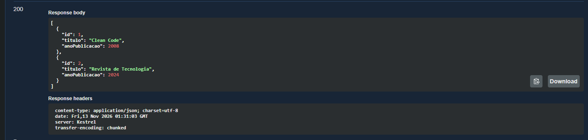
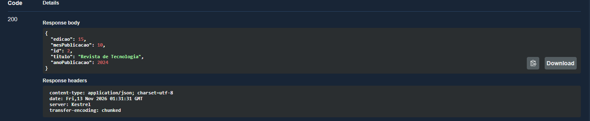
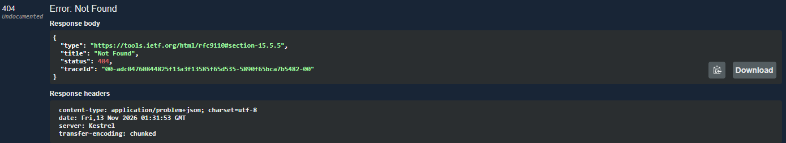
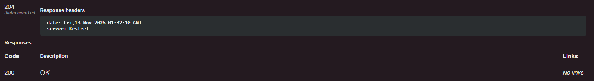
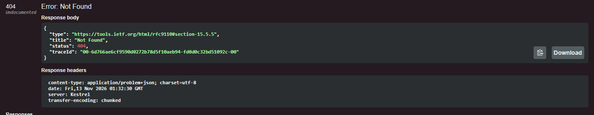
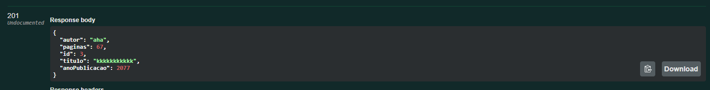
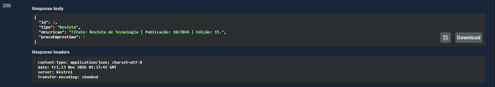
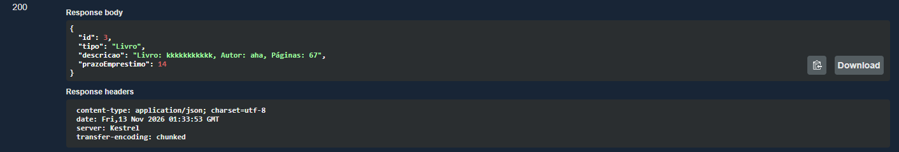
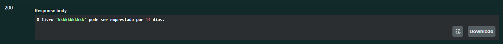
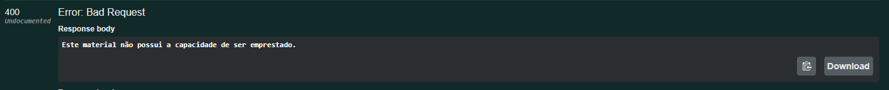

# MinhaBiblioteca - Sistema de Gerenciamento de Biblioteca Universitária

## Integrantes
1. Angelo Apontes Cabral 114.092
2. Daniel Próspero de Figueiredo 114.070
3. Gabriel Augusto Paulino Rodrigues 114.062
4. Pedro Pereira de Souza 114.047

## Descrição do sistema
Web API desenvolvida em .NET para o gerenciamento do acervo de uma biblioteca. Utiliza conceitos de Orientação a Objetos como herança, polimorfismo, abstração e interfaces, bem como padrões como Singleton e Repository Pattern. Os dados são salvos em memória.

## Tecnologias utilizadas
- C# / ASP.NET Core Web API
- Swagger para documentação e testes

## Como executar
1. Abra o terminal na pasta do projeto.
2. Execute o comando `dotnet run`.
3. Acesse `http://localhost:<porta>/swagger` no seu navegador.

## Principais endpoints
GET /api/Materiais
GET /api/Materiais/{id}
POST /api/Materiais/livro
POST /api/Materiais/revista
PUT /api/Materiais/livro/{id}
PUT /api/Materiais/revista/{id}
DELETE /api/Materiais/{id}
GET /api/Materiais/{id}/descricao
POST /api/Materiais/{id}/emprestar

## Evidencias de testes

